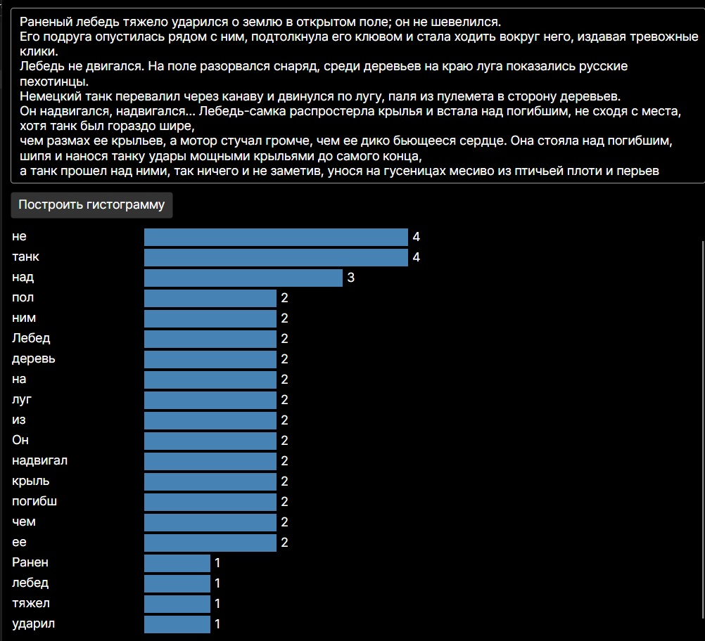

# 📊 WorldApp — частоты слов с русской морфологией

Кроссплатформенное десктопное приложение на **Avalonia UI**, которое анализирует произвольный русский текст, приводит слова к **основам** (отсекая окончания и возвратные постфиксы) и строит **горизонтальную гистограмму топ-20 самых частых основ**.

В отличие от «наивного» подсчёта слов, приложение объединяет разные словоформы одной лексемы: `мама`, `мамы`, `маме`, `маму` → одна основа `мам`.



## ✨ Возможности

- **Морфологическое упрощение**: отсечение окончаний по таблицам длиной от 1 до 6 букв, от длинных к коротким
- **Учёт возвратных форм**: постфиксы `-СЯ` / `-СЬ` отбрасываются до применения таблиц
- **Топ-20 основ** — сортировка по убыванию частоты, отсечение длинного хвоста
- **Гистограмма без внешних библиотек** — рисуется на `Rectangle` внутри `ItemsControl`, без ScottPlot/OxyPlot
- **Пропорциональные столбцы** — ширина каждого столбца нормализована относительно максимума (300 px)
- **Скроллируемый список** — удобно смотреть на большом количестве строк
- Кроссплатформенность: Windows, macOS, Linux

## 🛠️ Технологии

- **C# / .NET**
- **[Avalonia UI](https://avaloniaui.net/)** — кроссплатформенный UI-фреймворк
- **LINQ** и **регулярные выражения** — выделение слов и агрегация
- **Правила русской морфологии** — таблицы окончаний вручную

## 📋 Требования

- [.NET SDK](https://dotnet.microsoft.com/download) версии 6.0 или выше
- (опционально) IDE: Visual Studio 2022, JetBrains Rider или VS Code

## 🚀 Запуск

```bash
git clone https://github.com/ваш-username/world-app.git
cd world-app
dotnet restore
dotnet run
```

Либо откройте файл `.sln` в IDE и нажмите **Run / F5**.

## 🎯 Использование

1. Вставьте текст в поле ввода (поддерживается многострочный ввод).
2. Нажмите **«Построить гистограмму»**.
3. В нижней части окна появится список: **основа слова** — горизонтальный столбец — **количество вхождений**.

### Пример

**Ввод:**
```
Мама мыла раму. Мамы мыли рамы. Маме купили мыло.
```

**Результат (топ основ):**
```
мам    ████████████████████  3
мыл    ████████████████      2   (мыла + мыли + мыло → мыл)
рам    ████████████████      2   (раму + рамы → рам)
куп    ████████              1
```

## 🔬 Как это работает

### 1. Выделение слов

Регулярное выражение `[А-Яа-яЁё]+` находит все последовательности русских букв. Слова длиной 1 символ отбрасываются (обычно это предлоги/союзы), регистр сохраняется для будущего расширения под имена собственные.

### 2. Отсечение постфиксов

Если слово оканчивается на `-СЯ` или `-СЬ` — эти два символа удаляются первыми. Это позволяет дальше работать с «обычной» формой глагола:
- `мылся` → `мыл`
- `учиться` → `учить`

### 3. Таблицы окончаний

Окончания сгруппированы по длине — от 6 до 1 буквы:

| Таблица | Примеры |
|---|---|
| `End6` | `-АВШИСЬ`, `-ВШИЙСЯ`, `-ОВАНИЕ`, `-ЕВАНИЯ` |
| `End5` | `-ИТЬСЯ`, `-ЕНИЕМ`, `-ОСТЕЙ`, `-ЕЙШИЙ`, `-УЮЩИЙ` |
| `End4` | `-ЕТСЯ`, `-ЕНИЕ`, `-ОСТЬ`, `-ОГО`, `-ЛСЯ` |
| `End3` | `-АМИ`, `-ИТЬ`, `-ЕТ`, `-ЛА`, `-ОСТ` |
| `End2` | `-АЯ`, `-ЫЙ`, `-СЯ`, `-ТЬ`, `-ЕШ` |
| `End1` | `-А`, `-Е`, `-И`, `-Й`, `-О`, `-У`, `-Ы`, `-Ь`, `-Ю`, `-Я` |

Алгоритм идёт **от длинных к коротким**. Первое совпадение выигрывает — так `красивая` отбросит `-АЯ` (2 буквы), а не `-Я` (1 буква).

### 4. Подсчёт и построение

Основы складываются в `Dictionary<string, int>`. Затем — сортировка по убыванию, взятие топ-20, нормализация ширины столбца относительно максимума.

### Сложность

- По времени: `O(N · E)`, где `N` — количество слов, `E` — количество окончаний в таблицах (~150).
- По памяти: `O(U)`, где `U` — количество уникальных основ.

## 📁 Структура проекта

```
world-app/
├── MainWindow.axaml        # Разметка окна + DataTemplate гистограммы
├── MainWindow.axaml.cs     # GetStem() и обработчик клика
├── App.axaml / App.axaml.cs
├── Program.cs              # Точка входа
└── WorldApp.csproj
```

## ⚠️ Ограничения

Это **упрощённый стеммер на правилах**, а не полноценный морфологический анализатор:

- Нет словаря исключений → бывают ложные срабатывания (`весна` → `весн`, `вес` → `вес` — обе формы разные)
- Нет лемматизации: `человек` и `люди` останутся разными основами
- Регистр: `Мама` и `мама` сейчас дадут разные ключи (`Мам` / `мам`) — при необходимости приводите текст к нижнему регистру заранее
- Поддерживается только русский алфавит

Для сравнения: **Snowball stemmer** (Porter) для русского работает по другому принципу — через классы RV/R1/R2, а не через таблицы окончаний. Здесь выбран «прямой» подход ради наглядности.

## 🧪 Идеи для развития

- Приведение к нижнему регистру перед стеммингом (и/или отдельный флаг «учитывать имена собственные»)
- Экспорт гистограммы в PNG / CSV
- Переключение между **стеммингом** (основа) и **лемматизацией** (начальная форма)
- Замена эвристики на **Snowball** или **Mystem**
- Настройка **top-N** (сейчас жёстко 20)
- Юнит-тесты для `GetStem()`